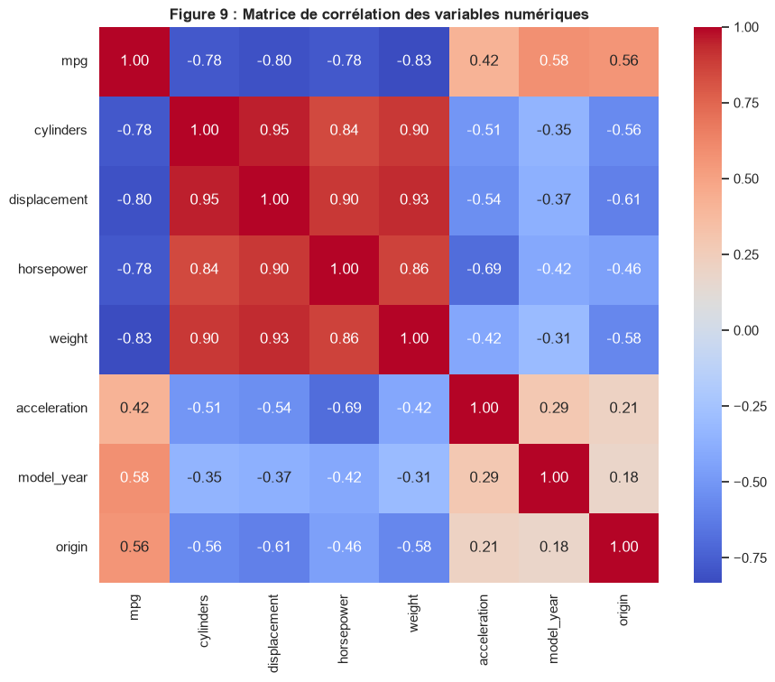
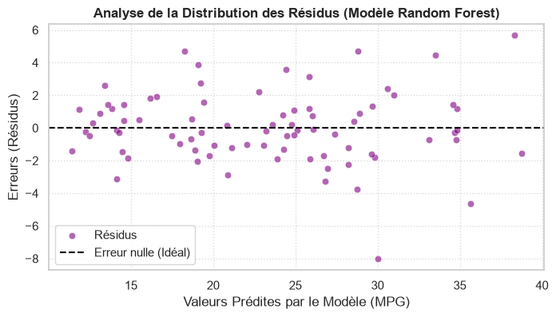

# 🚗 Fuel Consumption Prediction: Auto MPG (Data Mining)

> Academic project – **EMSI**, Knowledge Extraction / Data Mining module (2025–2026)
>
> Authors: **Inas Mourid** & **Khadija Bounaji** · Supervisor: Pr. Nadir Younes

An end-to-end data mining project that analyzes and predicts car fuel efficiency (**Miles Per Gallon**) from technical vehicle characteristics, using the **Auto MPG** dataset from the UCI Machine Learning Repository (cars built between 1970 and 1982).

## ✨ Results

| Model | R² (test) | MAE (test) | RMSE (test) |
|---|---|---|---|
| Linear Regression | 0.8449 | 2.29 | 2.89 |
| Ridge | 0.8447 | 2.29 | 2.89 |
| Lasso | 0.8376 | 2.34 | 2.96 |
| **Random Forest** 🏆 | **0.9122** | **1.62** | **2.17** |

**Random Forest explains 91.2% of the variance**, with an average error of only 1.62 MPG, clearly ahead of the linear models (~0.84). This confirms that the relationship between mechanical features and fuel consumption is **non-linear**.

The most influential variables are **weight**, **model year** and **origin**.

## 🔎 Methodology

1. **Problem understanding**: supervised regression, target = `mpg`
2. **Exploratory Data Analysis**: 9 commented visualizations (distributions, relationships, correlations)
3. **Data cleaning**: missing values in `horsepower`, duplicate checks, encoding of `origin`
4. **Preprocessing**: scikit-learn `Pipeline` + `ColumnTransformer` (standardization, one-hot encoding) to **prevent data leakage**
5. **Modeling**: Linear Regression, Ridge, Lasso, Random Forest
6. **Evaluation**: R², MAE, RMSE, residual analysis
7. **Interpretation & limits**: feature importance, dataset age, missing aerodynamic parameters

## 📊 Visuals

| Correlation matrix | Random Forest residuals |
|---|---|
|  |  |

## 🛠️ Tech stack

Python · Pandas · NumPy · Matplotlib · Seaborn · Scikit-learn · Jupyter

## 📂 Files

| File | Content |
|---|---|
| `AutoMPG_Project.ipynb` | Full notebook: EDA, cleaning, modeling, evaluation |
| `auto-mpg.data`, `auto-mpg.names` | Auto MPG dataset (UCI) and its description |
| `*.png` | Key figures |

## 🚀 Run

```bash
pip install -r requirements.txt
jupyter notebook AutoMPG_Project.ipynb
```

## 📚 Dataset

Quinlan, R. (1993). *Auto MPG* [Dataset]. UCI Machine Learning Repository.
